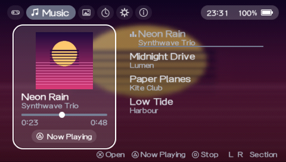
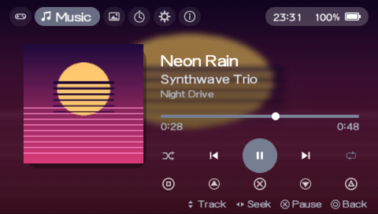
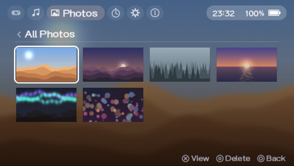
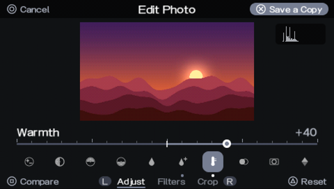
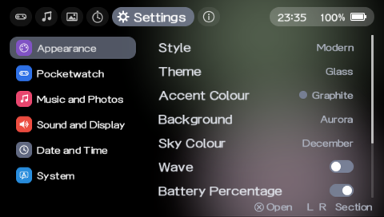
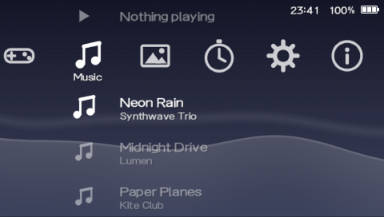
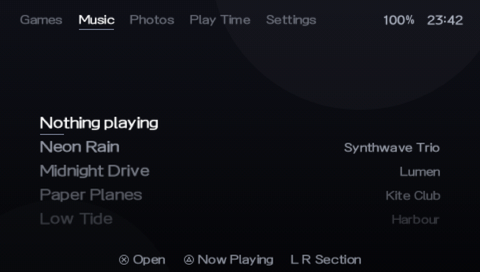

# Pocketwatch

> **P**ause. **S**ave. **P**lay.

Pocketwatch is a plugin for PSP custom firmware that puts time back in your hands:
freeze any game at any moment, keep the moment, and come back to it later.

A pocket watch is a precision instrument you carry everywhere. In watchmaking, every
feature beyond telling the time is called a *complication*. Pocketwatch follows the same
idea: one plugin, a growing set of complications.

## Screenshots

Pocketwatch Home, the home screen that comes with Pocketwatch, captured in PPSSPP with demo
content ([where the pictures come from](docs/assets/screenshots/README.md)):

| | |
|---|---|
|  |  |
| Music (Modern style) | Now Playing |
|  |  |
| Photos | The photo editor |
|  |  |
| Settings | Classic style, after the XMB |
|  | |
| Minimal style | |

## Complications

| Complication | Status | What it does |
|---|---|---|
| **States** | in development | Save, load and delete savestates per game, with slots and thumbnails |

More complications will follow once States is solid.

## Compatibility

| | |
|---|---|
| Firmware | ARK-4 (primary target). Other CFWs are untested. |
| Models | PSP-3000 (the only tested model). PSP-2000, PSP Go and PSP Street are untested. PSP-1000 is not supported for States (32 MB RAM). |
| Runlevel | `GAME` |

Do not run Pocketwatch States together with another savestate plugin
(PSPStates / Custom Home states): running two savestate engines at once is not supported.

## Install

1. Download `pocketwatch-<version>.zip` from [Releases](../../releases). Copy the `seplugins`
   and `PSP` folders from inside its folder to the root of the Memory Stick, merging them with
   the folders already there. That installs the game plugin, the XMB plugin, the overlay module
   and the translations to `seplugins/pocketwatch/`, and Pocketwatch Home to
   `PSP/GAME/PocketwatchHome/` and `PSP/SAVEDATA/ARK_01234/PWHOME.PBP`.
2. Add these lines to `ms0:/seplugins/PLUGINS.TXT` (`ef0:` on the PSP Go internal storage):

   ```
   UMD, ms0:/seplugins/pocketwatch/pocketwatch.prx, on
   VSH, ms0:/seplugins/pocketwatch/pocketwatch_xmb.prx, on
   ```

   `UMD` loads the game plugin for retail games only (UMD and ISO); ARK-4's `GAME` would include
   homebrew too. Add no line for `pocketwatch_perf.prx`: Home → Settings → Pocketwatch → Overlay
   in Games writes it.
3. Restart the PSP. XMB → Settings → Pocketwatch has the settings, including Start screen →
   Pocketwatch Home. Hold START at power-on to load no plugins, or L to get the XMB once.
4. Start a game. `ms0:/seplugins/pocketwatch/pocketwatch.log` shows the loaded version.

Each release's notes list the known issues and how to report a problem.

## Build

Requires the [PSPDEV toolchain](https://pspdev.github.io/) (`PSPDEV` defaults to `~/pspdev`).

```sh
# Linux / macOS / WSL
bash scripts/build.sh            # -> plugin/pocketwatch.prx
bash scripts/build.sh check      # import NIDs vs ARK-4 6.61 + size budgets
bash scripts/build.sh clean
make -C tests                    # host unit tests (ASan + UBSan)
bash scripts/format.sh --check   # clang-format 18.1.8
```

```bat
:: Windows, toolchain installed in WSL (the .cmd wrappers bypass the PowerShell script policy)
scripts\build.cmd
scripts\build.cmd -Target check
scripts\deploy.cmd -Enable       :: copy to the PSP over USB and register in PLUGINS.TXT
```

Every push runs the host tests, the format check, the PSP build and `make check` on GitHub
Actions; pushing a `v*` tag publishes a release with the zip.

## Project layout

```
plugin/                  kernel PRX (Makefile, exports.exp)
  src/core/main.c        module entry, starts the complications
  src/core/log.c         RAM ring-buffer log -> pocketwatch.log next to the PRX
  src/core/selfcheck.c   on-device check that every import resolved
  src/core/platform*.c   OS services, so portable modules also build on the host
  lib/                   third-party code (stb_sprintf)
vsh/                     XMB plugin (Settings -> Pocketwatch / Battery, Game -> Play Time)
home/                    Pocketwatch Home, the home-screen application (EBOOT.PBP)
perf/                    in-game performance overlay module
tests/                   host unit tests
tools/check_prx.py       static import/size checks; NID tables in tools/nids/
scripts/                 build, deploy and format helpers
.github/                 CI, issue templates
```

## Documentation

Design, status and research live in [`docs/`](docs/README.md): start with the
[documentation index](docs/README.md), the [roadmap](docs/roadmap.md) and the
[project status](docs/project-status.md).

## Prior art

Pocketwatch is written from scratch, but stands on the shoulders of:

- [PSPStates](https://github.com/PSP-Archive/PspStates-Experiment) by Dark_Alex - the original PSP savestate plugin
- [Custom Home Mod](https://github.com/PSP-Archive/Custom-Home-Mod) by ABCanG and suloku - in-game HOME menu with PSPStates integration
- [PSPFatSave](https://github.com/Grunwalskii/PSPFatSave-Public) - savestates on the PSP-1000
- [ARK-4](https://github.com/PSP-Archive/ARK-4) and [PSPDEV](https://github.com/pspdev)

## License

Pocketwatch is free software, licensed under the
[GNU General Public License v3.0 or later](LICENSE) (`GPL-3.0-or-later`).
Bundled third-party code keeps its own license (noted in each file's header).
Sony firmware assets (fonts, icons) are never redistributed - they are read at runtime
from the user's own PSP.
