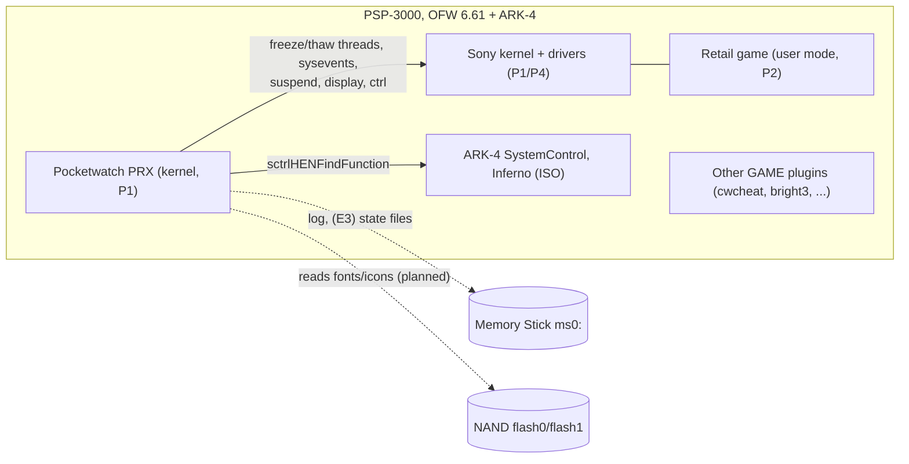
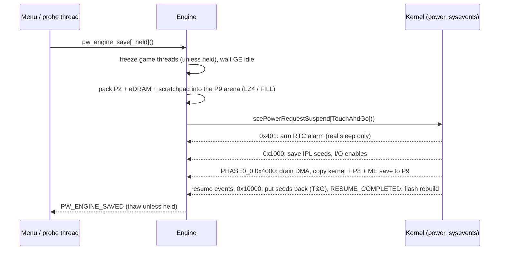

# System architecture

Status of this document: describes the **current** implementation (commit `1f8d6c4`, 2026-10-16)
and, where marked **PROPOSED**, the approved target. Subsystem details live in the specs linked
from the [system map](02-system-map.md).

## 1. Context

Pocketwatch is one kernel-mode PRX (`plugin/pocketwatch.prx`, module `Pocketwatch`) that ARK-4
loads into every retail game (runlevel `UMD`). It runs next to the game, Sony's kernel and the
other plugins, and uses only firmware and ARK-4 kernel APIs.

## 2. Layers and modules

| Layer | Directory | Modules (current) | Rule |
|---|---|---|---|
| Core runtime | `plugin/src/core/` | `main` (lifecycle), `log` + `ring` (RAM ring log), `platform_psp` (OS shim), `mem` (P9/P11 blocks), `freeze` (game threads), `flash` (flash driver rebuild), `lz` (LZ4 codec), `crc32`, `png`, `selfcheck` + `stubinfo` (import check), `stubs/*.S` | Services used by every complication. Portable ones (`log`, `ring`, `lz`, `crc32`, `png`, `stubinfo`) include no PSP header. |
| Complications | `plugin/src/complications/<name>/` | `states/`: `engine` + `handoff.S` (save/load), `stream` (chunked codec), `sfo` + `savedata_hash` (native save files, M5) | One folder per complication. |
| Shell | `plugin/src/shell/` | `shell` (HOME ownership, trigger thread, freeze/masks around the hub, Quit Game) | PSP only. |
| UI | `plugin/src/ui/` | `draw`, `shapes`, `icons`, `views` (every screen's drawing), `font8x8`, `input` (portable); `fb` (overlay framebuffer), `ui`, `hub`, `dialog` (PSP) | Portable drawing/input is host-tested and previewed (`make -C tests preview`). |
| GFX | `plugin/src/gfx/` | `pgf` (system font reader), `text` (glyph cache, scaling, layout) portable; `assets` (reads flash0 at start) | Sony files read at runtime only. |
| Debug | `plugin/src/debug/` | `probe` (button combos, dumps), `bench` (codec throughput) | Only in `DEBUG=1` builds. |
| Third party | `plugin/lib/` | `lz4` 1.10.0 (BSD-2), `stb_sprintf` (MIT/PD) | Unmodified upstream code, own license headers. |
| Host side | `tests/`, `tools/`, `scripts/` | unit tests, NID/size checks, SFO tool, build/deploy | See [build and verification](subsystems/build-and-verification.md). |

**PROPOSED** (plan, [ADR-009](architecture/decisions.md#adr-009--complication-framework-and-ui-layering)): a `gfx/` layer (PGF text, RCO/GIM
images, animation) between `ui/` and the framebuffer, a `pw_complication` registry so the hub
builds its items from complications, `core/` services for config, game identity, power locks and
guards.

## 3. Execution contexts

| Context | Created by | Runs | Constraints |
|---|---|---|---|
| `module_start` | ARK-4 plugin loader | starts `PocketwatchMain`, returns at once | no blocking |
| `PocketwatchMain` (prio 0x20) | `module_start` | log init, import self-check, `pw_engine_init` (sysevent handler), debug probe, system font (`pw_assets_init`), shell thread; then exits | |
| `PocketwatchShell` (prio 0x20) | `pw_shell_start` | polls buttons every 20 ms; takes HOME over once the game registered its exit callback; on HOME (or the NOTE fallback) freezes the game and runs the hub; Quit Game | owns the display and the buttons while open |
| Probe thread (debug) | `pw_probe_start` | debug combos (save/load/self-test/dump/benchmark) | ignores combos while the hub is open |
| Sysevent handler | `sceKernelRegisterSysEventHandler` (mask `0x00FFFF00`) | engine: RTC alarm at `0x401`, kernel capture or rollback at PHASE0_0 (`0x4000`), IPL seeds and touch-and-go fixes at `0x1000`/`0x10000`, flash rebuild at RESUME_COMPLETED (`0x400000`) | **no file I/O, no logging to the card** (deferred log), tiny stack |
| Apply blob | copied into P9, entered at PHASE0_0 with Status.IE masked | copies the kernel image back, flushes caches, returns into the save-time dispatcher (`handoff.S`) | runs from P9, never P11 |
| `module_stop` | kernel at game exit | stops and joins every plugin thread, unregisters the handler, frees memory | no file I/O; no thread may outlive it (M1 incident) |

## 4. Memory ownership

**VERIFIED** on the PSP-3000 in retail games ([M1](research/m1-hardware.md),
[E2](research/m2-engine.md)):

| Region | Size | Owner | Pocketwatch use |
|---|---|---|---|
| P1 + P4 kernel `0x88000000-0x88400000` | 4 MB | Sony kernel, plugins | the module (loaded sections 95,013 B release / 102,516 B debug, 2026-10-16); captured whole in a state |
| P2 game `0x08800000` | 24 MB | game | saved/restored; highmem (other sizes) is refused |
| P5 volatile `0x08400000` | 4 MB | game (optional) | a game using it is refused (not supported yet); GE saves eDRAM here during a suspend |
| P8 `0x8BB00000` | 1 MB | system (343 KB used, owner unknown) | captured with the kernel |
| **P9** `0x8A000000` | 24 MB | free during gameplay | **all state data** from the partition's base: header, codec workspace, apply blob, kernel image 4 MB + P8 1 MB + ME save 4 MB, then the packed arena (~14.6 MB); at the top a ~190 KB block with the system font and its glyph caches |
| P11 `0x8BC00000` | 4 MB | firmware: ME eDRAM save area **during every suspend** | scratch only: the hub's screen (4 x 544 KB pages: bright and dimmed game frame, two draw pages); never across a suspend |
| eDRAM (VRAM) `0x04000000` | 2 MB | game / GE | saved/restored |
| Scratchpad `0x00010000` | 16 KB | game | saved; comes back with the kernel's resume block |

Rules (all in `CLAUDE.md`): data that must survive a suspend lives in P9 only; P11 and P5 are
overwritten by the firmware during a suspend; nothing large goes into P1.

## 5. Key flows

### Save (current, E2 + fast mode)

### Load (current)

The engine freezes the game, marks `g_restore_pending` inside the staged kernel image, requests a
suspend and at PHASE0_0 jumps to the apply blob, which copies the image over the live kernel and
returns into the **save's** suspend. The system resumes the restored kernel; the save-time thread
returns from `pw_engine_save` a second time with `PW_ENGINE_LOADED`, unpacks RAM/eDRAM,
rebuilds the flash drivers (mandatory, [ADR-006](architecture/decisions.md#adr-006--rebuild-the-flash-drivers-after-every-resume))
and thaws. Details: [states engine spec](subsystems/states-engine.md).

## 6. External dependencies

| Dependency | Used for | Evidence / risk |
|---|---|---|
| ARK-4 NID resolver | every randomized 6.61 kernel NID | `make check` against `tools/nids/ark4_660.tsv`; boot self-check logs unresolved imports |
| ARK-4 `sctrlHENFindFunction` | chnnlsv, flash driver functions | [RISK-008](risk-register.md#risk-008--ark-4-api-or-nid-table-changes) |
| Firmware power/sysevent sequence | capture and rollback at PHASE0_0 | VERIFIED on 6.61 PSP-3000 only |
| lflash / flashfat `df_exit`/`df_init` | flash driver rebuild | VERIFIED (E2 runs 6-7) |
| `chnnlsv.prx` | SFO hashes the XMB accepts | VERIFIED (S2b) |
| Memory Stick FAT driver | log now, state files in E3 | behaviour after a rollback is **RESEARCH REQUIRED** (T1, [RISK-001](risk-register.md#risk-001--memory-stick-fat-corruption-after-a-rollback)) |

## 7. Build profiles

`DEBUG=1` (default while developing): probe, benchmark, extra checksums and logging; PRX budget
112 KB. `DEBUG=0` (release): no probe, 90.6 KB. Both must pass `make check` (imports, size and
memory budgets). See [build and verification](subsystems/build-and-verification.md).
