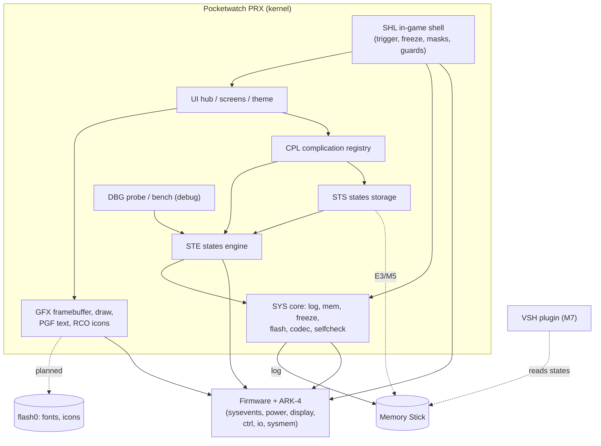

# System map

Every subsystem, its status and its specification. Status words: **Done** (implemented and
verified on the device), **Partial** (some requirements done), **Planned** (specified, no code),
**Research** (feasibility not established). Milestones refer to the [roadmap](roadmap.md).

## 1. Subsystem inventory

| Area | Subsystem | Status | Code | Spec | Depends on |
|---|---|---|---|---|---|
| `SYS` | Core runtime: lifecycle, log, memory, freeze, flash rebuild, codec, import self-check | Done (config, game identity, power locks: Planned) | [`plugin/src/core/`](../plugin/src/core/) | [core-runtime](subsystems/core-runtime.md) | firmware, ARK-4 |
| `STE` | States engine: save/load within a boot (E1/E2), fast mode | Done (E1, E2); E4 Planned | [`plugin/src/complications/states/`](../plugin/src/complications/states/) | [states-engine](subsystems/states-engine.md) | SYS |
| `STS` | States storage: Memory Stick files (E3), native SAVEDATA folders (M5) | Planned (SFO/PNG/hash helpers Done) | `states/sfo.c`, `states/savedata_hash.c`, `core/png.c` | [states-storage](subsystems/states-storage.md) | STE, SYS |
| `SHL` | In-game shell: trigger button, freeze for the menu, button masking, guards, Quit Game | Partial (NOTE trigger, freeze, masking Done; HOME, guards, Quit Planned) | [`plugin/src/ui/menu.c`](../plugin/src/ui/menu.c) | [game-shell](subsystems/game-shell.md) | SYS, UI |
| `UI` | Interface: hub, state list, dialogs, theme, navigation, i18n | Partial (phase-1 menu Done; XMB look Planned) | [`plugin/src/ui/`](../plugin/src/ui/) | [ui](ui/README.md) | GFX, SHL, CPL |
| `GFX` | Rendering and native assets: overlay framebuffer, drawing, PGF fonts, RCO/GIM icons | Partial (framebuffer, 8x8 text Done; PGF, RCO Planned) | `ui/fb.c`, `ui/draw.c` | [rendering](ui/rendering.md) | SYS |
| `CPL` | Complication framework: registry, items, lifecycle; System and Settings complications | Planned | — | [complications](subsystems/complications.md) | SYS, UI |
| `DBG` | Debug tooling: combos, dumps, benchmark, diagnostics | Done | [`plugin/src/debug/`](../plugin/src/debug/) | [debug-tooling](subsystems/debug-tooling.md) | STE, SYS |
| `BLD` | Build and verification: scripts, NID/size checks, host tests, CI, format, docs check | Done | [`scripts/`](../scripts/), [`tools/`](../tools/), [`tests/`](../tests/) | [build-and-verification](subsystems/build-and-verification.md) | — |
| `VSH` | XMB integration: continue a game from a state (M7) | Planned | — | [vsh-integration](subsystems/vsh-integration.md) | STS |
| `FW` | Independent firmware feasibility | Research | — | [feasibility study](firmware/independent-firmware-feasibility.md) | — |

## 2. Interaction map

Current wiring differs from this target in one place: the phase-1 menu
([`ui/menu.c`](../plugin/src/ui/menu.c)) calls the engine directly; CPL does not exist yet.

## 3. Shared resources and who owns them

| Resource | Owner | Users | Rule |
|---|---|---|---|
| Game threads (freeze) | whoever froze them (engine or menu) | SHL, STE, DBG | the freezer thaws; `pw_engine_*_held` when the caller froze ([engine.h](../plugin/src/complications/states/engine.h)) |
| Display (overlay) | GFX while the menu is open | UI | released before any suspend (P11) |
| Buttons | SHL while the menu is open | UI | masked from the game, restored only after every button is up |
| P9 block | STE | STS (E3 file I/O from/to P9) | must survive suspends |
| P11 | GFX (scratch) | — | never across a suspend |
| Memory Stick writes | **nobody arbitrates yet** | SYS log, STS, game saves | while a state is held only deferred logging protects it ([RISK-001](risk-register.md#risk-001--memory-stick-fat-corruption-after-a-rollback)) |
| Sysevent handler | STE | SYS flash rebuild | no I/O |

## 4. Architecture review (2026-10-16 audit)

Findings from reading the code against the plan. Each is **INFERRED** from the code unless noted;
the follow-up is tracked in [project status](project-status.md).

| # | Finding | Why it matters | Proposed action |
|---|---|---|---|
| A1 | No complication boundary: the menu hard-codes Save/Load/Resume and calls the engine. | Owner priority 3 (extension); every new feature would edit `menu.c`. | Introduce CPL with the hub rewrite (M3/M4). |
| A2 | No arbiter for Memory Stick writes while a state is held; only the log is deferred. | A game save or any plugin write between save and load may corrupt the FAT after a rollback. | T1 test decides the policy; then a `pw_ms_write_allowed()` gate in SYS used by every writer ([STS](subsystems/states-storage.md)). |
| A3 | Two engine drivers (menu thread, debug probe) coordinate only through `pw_menu_is_open()`. | A probe save racing a menu save would double-freeze. | One engine-owner lock in STE when HOME lands. |
| A4 | `sfo.c`, `savedata_hash.c` and `png.c` are linked into the PRX but have no caller (spike S2b code was removed). | A few KB of the size budget. **VERIFIED** by grep. | Keep (M5 needs them) but count them in the budget; or link only when STS lands. |
| A5 | `engine.c` (1.7k lines) mixes the save/load core, sysevent handling, touch-and-go fixes and diagnostics. | E3 adds file I/O and fingerprints; review gets harder. | Split diagnostics/trace into `states/diag.c` when E3 starts. |
| A6 | README listed PSP-2000/Go/Street as compatible; only the PSP-3000 is tested. | Overclaim. | README corrected in this change. |
| A7 | CHANGELOG `[Unreleased]` still describes FastLZ and lacks LZ4, fast mode, the menu. | Stale user-facing notes. | Rewrite at the next release cut (M6). |
| A8 | Research notes reference removed spike sources (`debug/spike_savedata.c`, `spike_suspend.c`). | Historical notes; the code is in git history. | Leave as history; no action. |
