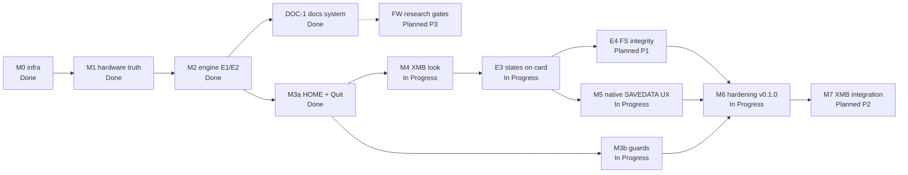

# Roadmap

The approved plan (2026-10-04) put the engine before the UI because the engine decides the UX.
The engine's same-boot ladder is done; on 2026-10-16 the owner moved the native shell (HOME + XMB
look) ahead of E3. No dates: effort is estimated only where there is evidence.

## Priorities

| Priority | Meaning |
|---|---|
| **P0** | Blocks the owner's main use or risks data/device damage. Next in line. |
| **P1** | Needed for v0.1.0. |
| **P2** | Valuable, after v0.1.0 or when convenient. |
| **P3** | Idea or research; no commitment. |

States: **Planned**, **In Progress**, **Blocked**, **Done**. Work types: *Doc*, *Research*,
*Prototype*, *Implementation*, *Validation*.

## Overview

| Milestone | Type | Priority | State |
|---|---|---|---|
| [M0 — infrastructure](#m0--infrastructure) | Implementation | — | Done |
| [M1 — hardware ground truth](#m1--hardware-ground-truth) | Research | — | Done |
| [M2 — engine ladder E1/E2 + speed](#m2--engine-ladder-e1e2-and-speed) | Implementation | — | Done |
| [M3-phase1 — minimal menu](#m3-phase-1--minimal-menu) | Implementation | — | Done |
| [DOC-1 — documentation system](#doc-1--documentation-system) | Doc | P0 | Done |
| [M3a — HOME takeover and Quit Game](#m3a--home-takeover-and-quit-game) | Research + Implementation | P0 | Done (device-verified 2026-10-16) |
| [M4 — native look (XMB-style hub)](#m4--native-look-xmb-style-hub) | Research + Implementation | P0 | In Progress (implemented incl. i18n; owner review) |
| [E3 — states on the Memory Stick](#e3--states-on-the-memory-stick) | Research + Implementation | P0 | In Progress (T1 passed; implemented, T1b-T6 pending) |
| [M3b — guards](#m3b--guards) | Implementation | P1 | In Progress (implemented, device tests G1-G7 pending) |
| [E4 — file-system integrity gate](#e4--file-system-integrity-gate) | Validation | P1 | Planned (protocol in the testing guide) |
| [M5 — States UX on native saved data](#m5--states-ux-on-native-saved-data) | Implementation | P1 | In Progress (implemented, device tests M1-M12 pending) |
| [M6 — hardening, v0.1.0](#m6--hardening-v010) | Validation | P1 | In Progress (release build, changelog, testing guide) |
| [M7 — XMB integration](#m7--xmb-integration) | Implementation | P2 | In Progress (variant B, GAME side implemented) |
| [Speed backlog S1-S7](#speed-backlog) | Research | P2 | Planned |
| [FW — independent firmware research](#fw--independent-firmware-research) | Research | P3 | Planned |

## M0 — infrastructure

Done (2026-10-04). Folder structure, RAM ring log, `core/platform.h` + host tests, CI (tests,
`-Werror`, size budget, NID check, clang-format). Evidence: commits `39326c7`..`97df966`.

## M1 — hardware ground truth

Done (2026-10-04). Memory map in a retail game, savedata visibility (hash required).
[m1-hardware](research/m1-hardware.md).

## M2 — engine ladder E1/E2 and speed

Done (2026-10-16). Capture during a suspend (E1), same-boot load (E2, run 7), LZ4, fast mode,
IPL-seed fix. First save 7.8 s, later saves 4.2 s, loads 3.9 s (Castlevania).
[m2-engine](research/m2-engine.md), [m2-speed](research/m2-speed.md).

## M3 phase 1 — minimal menu

Done (2026-10-16, device-verified). NOTE tap opens Save/Load/Resume over the dimmed game; own
framebuffer in P11; held-freeze engine API. [m3-menu-e3](research/m3-menu-e3.md).

## DOC-1 — documentation system

- **Objective:** a persistent source of truth: workflow imported by `CLAUDE.md`, index, overview,
  architecture, system map, specs for every subsystem, roadmap, status, risks, glossary, UI spec
  with references and concepts, firmware feasibility study, `tools/check_docs.py`.
- **Why now:** the owner asked for it (2026-10-16); the UI work that follows needs a spec.
- **Deliverables:** `docs/**`, `CLAUDE.md` import, `tools/check_docs.py`.
- **Acceptance:** `python tools/check_docs.py` passes; every subsystem in the [index](README.md)
  has a spec; a fresh session shows `docs/AI_WORKFLOW.md` in `/context` → Memory files.
- **State:** Done; kept current with every change ([project status](project-status.md)).

## M3a — HOME takeover and Quit Game

- **Objective:** HOME (PS) opens the hub instead of the system HOME screen; the hub has Quit Game.
- **Why P0:** owner requirement ([ADR-012](architecture/decisions.md#adr-012--home-opens-the-hub-and-replaces-the-system-home-screen)); the NOTE trigger was temporary.
- **Prerequisites:** research on impose/HOME handling and native quit
  ([game shell](subsystems/game-shell.md), RESEARCH REQUIRED).
- **Deliverables:** SHL changes, Quit Game item, docs; device test protocol.
- **Requirements:** `SHL-REQ-001`..`SHL-REQ-006`, `SHL-REQ-011`, `SHL-REQ-012`, `CPL-REQ-005`.
- **Acceptance:** HOME opens the hub in gameplay with no flash of the system popup; HOME again or
  O closes it; Quit Game returns to the XMB in < 5 s with settings intact; a game's own HOME
  disable is respected; the NOTE button keeps its system function (mute).
- **Risks:** [RISK-009](risk-register.md#risk-009--home-takeover-side-effects).

## M4 — native look (XMB-style hub)

- **Objective:** the hub, list and dialogs look like the system UI: PGF system font, XMB metrics
  and colours, system icons from RCO, native button order (○/× per region), system language.
- **Why P0:** owner priority 1; the phase-1 look was a placeholder.
- **Prerequisites:** PGF/RCO/GIM research ([rendering](ui/rendering.md)), UI spec and concepts
  ([ui](ui/README.md)), owner review of the concepts.
- **Deliverables:** `gfx/` (PGF text, RCO/GIM images), theme table, hub + dialog widgets, host
  tests (golden images), CPL registry.
- **Requirements:** `UI-REQ-*`, `UI-NFR-*`, `GFX-REQ-*`, `CPL-REQ-*`.
- **Acceptance:** side-by-side comparison with the reference set accepted by the owner; menu opens
  in < 300 ms; no asset → fallback still usable; PRX within budget.
- **Risks:** [RISK-005](risk-register.md#risk-005--kernel-ram-and-prx-size-growth), [RISK-010](risk-register.md#risk-010--parsing-sony-assets-on-the-device).

## E3 — states on the Memory Stick

- **Objective:** a state survives a reboot: written to the card, loaded in a later boot.
- **Prerequisites:** test T1 (FAT freshness after a rollback) decides the write policy.
- **Deliverables:** STS file layout, preallocation, fingerprint, freshness probe; tests T0-T6.
- **Requirements:** `STS-REQ-001`..`STS-REQ-010`.
- **Acceptance:** T1-T6 pass ([m3-menu-e3](research/m3-menu-e3.md)); a PC FAT check after T4 is
  clean.
- **Risks:** [RISK-001](risk-register.md#risk-001--memory-stick-fat-corruption-after-a-rollback), [RISK-006](risk-register.md#risk-006--cross-boot-load-into-a-different-environment).

## M3b — guards

Implemented 2026-10-16 (`shell/guard.c`): low battery without the adaptor, USB mass storage, WLAN
in use, highmem, Custom Home / PSPStates; the hub does not open over a system dialog, during a save
or load, or within 2 s of a wake; the hub redraws after a sleep. Not guarded: video playback
(INFERRED safe), TV-out (OPEN QUESTION); a full card is caught by the short write; `mscache` is
handled by the check after a load. Requirements `SHL-REQ-007`..`SHL-REQ-010`. Risk RISK-007,
RISK-015. Device tests: [testing guide](testing.md#7-guards).

## E4 — file-system integrity gate

100 save/load cycles with game saves in between, a PC FAT check every 10 cycles, file hashes
compared. Acceptance: zero FAT errors, zero changed files. Requirement `STE-NFR-004`.

## M5 — States UX on native saved data

Implemented 2026-10-16: the state list in the Saved Data Utility's layout (`ui/slots.c`), five
slots per game as SAVEDATA folders with ICON0/PIC1/hashed SFO
([ADR-010](architecture/decisions.md#adr-010--states-are-native-hashed-savedata-folders)), STATE.BIN as the commit record, overwrite and delete confirmations.
Requirements `STS-REQ-011`, `STS-REQ-012`, `UI-REQ-009`, `UI-REQ-010`. Device tests:
[testing guide](testing.md#4-states-on-the-memory-stick).

## M6 — hardening, v0.1.0

Compatibility matrix on the owner's 22 ISOs (`docs/compat.md`), error handling, release build,
changelog, tag → CI release. Release gate: 100 cycles on 5 games without failure; every refusal
native; settings and card intact.

## M7 — XMB integration

Continue a game from a state from the XMB: "Continue from Save State" in the game's △ menu
(ADR-020), the ISO launched the XMB's way, the slot loaded once the game runs (GAME side done:
`continue.txt`, test V1). Next: research the XMB's △ menu call sites, then the VSH PRX.
[vsh-integration](subsystems/vsh-integration.md). Also under M7 since 2026-10-20: Home keeping
the clock, Pocketwatch's battery calibration and the performance overlay (ADR-041..043, device
tests HM29-HM31, PF1-PF2; [perf-overlay](subsystems/perf-overlay.md)).

## Speed backlog

S1-S7 in [backlog](backlog.md): slow suspend handlers, overlap packing with the suspend, skip the
flash rebuild when safe, no real sleep on the first save, cheaper verification, the 0x402 veto,
hand-written LZ4. P2: picked up between milestones.

## FW — independent firmware research

Research only, gated ([ADR-015](architecture/decisions.md#adr-015--independent-firmware-is-a-gated-research-track)); never blocks the plugin. Gates:

| Gate | Question | Exit criterion |
|---|---|---|
| FW-G1 | Hardware and software baseline | Inventory of the PSP-3000's hardware and the 6.61 software stack with sources |
| FW-G2 | Documentation and tool audit | List of documented vs undocumented blocks, available tools (uOFW, PPSSPP, pspdev, IPL SDKs) |
| FW-G3 | Boot and execution constraints | Which boot entry points exist on this board, what code can run where, recovery options |
| FW-G4 | Dependency and compatibility matrix | Which Sony modules each option keeps; which models each option can reach |
| FW-G5 | Proof of concept for the most uncertain assumption | One measurable PoC agreed by the owner, with a recovery path |
| FW-G6 | Comparison with simpler options | Options A-E scored on independence gained vs cost and risk |
| FW-G7 | Go / no-go | ADR recording the decision |

Details and current findings: [feasibility study](firmware/independent-firmware-feasibility.md).
