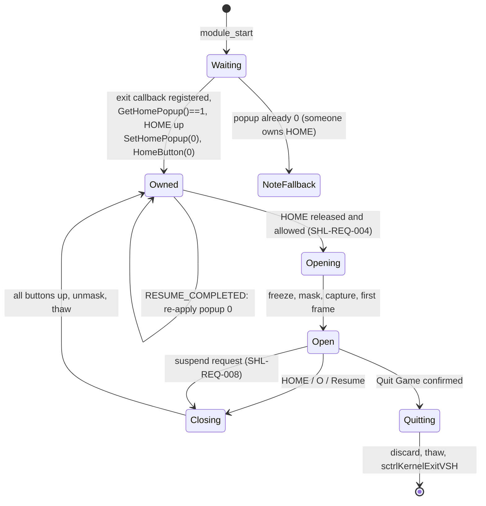

# In-game shell — specification

| | |
|---|---|
| Area code | `SHL` |
| Status | Partial: NOTE-tap trigger, freeze, button masking, release wait, display hand-off (Done, device-verified 2026-10-16). HOME takeover, Quit Game, guards, power handling (Planned) |
| Milestones | M3 phase 1 (done), M3a (HOME + Quit), M3b (guards) |
| Code | [`ui/menu.c`](../../plugin/src/ui/menu.c) (trigger thread and menu loop today), [`ui/input.c`](../../plugin/src/ui/input.c), [`core/freeze.c`](../../plugin/src/core/freeze.c) |
| Research | [m3-home-takeover](../research/m3-home-takeover.md), [m3-menu-e3](../research/m3-menu-e3.md) |

## A. Overview

- **Purpose:** everything between "the user pressed the button" and "the hub is on screen with the
  game safely paused", and back: the trigger, the freeze, taking the display and the buttons from
  the game, refusing unsafe moments, closing cleanly, and quitting the game.
- **User benefit:** one button (HOME) that always behaves like the system's own, never leaks
  presses to the game, never opens when it would be unsafe.
- **Non-goals:** what the hub shows (→ [UI](../ui/README.md)), how drawing works
  (→ [rendering](../ui/rendering.md)).
- **Current state (VERIFIED, menu test 2026-10-16):** a short NOTE tap (≤ 400 ms, no other button)
  freezes the game, masks `0xFFFF` from the game, captures the frame, shows the menu; closing waits
  until every button is up, unmasks, thaws. The system HOME screen still works as before.
- **Target state:** HOME replaces the system HOME screen ([ADR-012](../architecture/decisions.md#adr-012--home-opens-the-hub-and-replaces-the-system-home-screen)), Quit Game in the hub, guards,
  power-event handling.

## B. Requirements

| ID | Requirement | Priority | Status | Verification |
|---|---|---|---|---|
| `SHL-REQ-001` | A HOME press (pressed → released) in gameplay opens the hub; the system HOME screen never appears, not even for one frame. | P0 | Planned | device test M3a |
| `SHL-REQ-002` | HOME, O (back) or the Resume item close the hub; the game receives none of the presses made while it was open, including the one that closed it. | P0 | Done for NOTE/O/START; HOME Planned | device test 2026-10-16 |
| `SHL-REQ-003` | If the game (or another plugin) disabled the HOME popup, the hub does not open on HOME and the game's choice is kept; the original popup state is restored at `module_stop`. | P0 | Planned | device test with such a game; code review |
| `SHL-REQ-004` | The hub does not open while a system utility dialog is loaded (`sceVshSDUtility_Module`, `sceDialogmain_Module`, OSK, netconf), while HOLD is on, during an engine operation, or within 2 s after a resume. | P0 | Planned | device test |
| `SHL-REQ-005` | Quit Game asks for confirmation in the native style, then returns to the XMB like the system's quit: state discarded, IPL seeds in place, log flushed, game thawed, `sctrlKernelExitVSH`. XMB reached in ≤ 5 s; settings intact. | P0 | Planned | device test M3a |
| `SHL-REQ-006` | While the hub is open the game is frozen, the display shows the hub, the backlight stays on (`scePowerTick`) and the game's own frame is never modified. | P0 | Done | device test 2026-10-16 |
| `SHL-REQ-007` | Guards refuse to open the hub's state actions (with a native message) when USB is connected, a network connection is up, or a video is playing. | P1 | Planned | device tests per guard |
| `SHL-REQ-008` | A suspend request (POWER switch, auto-sleep, low battery) while the hub is open closes the hub, gives back display and buttons and thaws before the suspend proceeds. | P1 | Planned | device test: slide POWER with the hub open |
| `SHL-REQ-009` | Guards refuse a save when the battery is below ~15 % without a charger or the card lacks space, and refuse everything under highmem or TV-out. | P1 | Planned | device tests |
| `SHL-REQ-010` | When PSPStates / Custom Home or ARK `mscache` is active, States refuses with a message naming the conflict. | P1 | Planned | device test with the conflicting setup |
| `SHL-REQ-011` | Once HOME is the trigger, the NOTE button keeps its system function (mute on hold) and opens nothing. | P0 | Planned | device test |
| `SHL-REQ-012` | ARK-4's exit combos (L+R+START/SELECT+DOWN) cannot reboot the PSP while a state is held without the state being discarded first. | P1 | Planned (RESEARCH REQUIRED) | code review + device test |
| `SHL-NFR-001` | First hub frame ≤ 300 ms after the HOME release (freeze timeout 500 ms worst case). | P1 | Planned (phase 1 not measured) | log timestamps |
| `SHL-NFR-002` | No cost while closed: one kernel thread polling every 20 ms, no allocation. | P1 | Done | code |

## C. Architecture and integration

**Current (phase 1):** `PocketwatchMenu` thread polls `sceCtrlPeekBufferPositive` every 20 ms;
`pw_tap_update` recognises the NOTE tap; `run_menu` freezes (500 ms), masks game buttons
(`sceCtrlSetButtonMasks(0xFFFF, 1)`), waits for the GE, opens the framebuffer, loops at vblank,
calls the engine with the held freeze, and on close waits for all buttons up, unmasks, thaws.

**Target (PROPOSED, from [m3-home-takeover §6](../research/m3-home-takeover.md#6-recommended-design-proposed)):**

- **Shell module (PROPOSED):** move the trigger thread and the open/close sequence out of
  `ui/menu.c` into `shell/shell.c` (`pw_shell_start/stop`, `pw_shell_is_open`), so the hub only
  draws and handles items. `ui/input.c` stays the portable button logic (tap, repeat).
- **Interfaces used:** `sceImposeSetHomePopup/GetHomePopup/HomeButton` (sceImpose_driver),
  `sceKernelCheckExitCallback`, `sceCtrlPeekBufferPositive`, `sceCtrlSetButtonMasks`,
  `pw_freeze_game/thaw`, `pw_fb_*`, `pw_engine_*_held`, ARK `sctrlKernelExitVSH`,
  `sctrlSESetUmdFile`, `sctrlSESetBootConfFileIndex`, `sceDisplaySetHoldMode`.
- **Hook (PROPOSED):** redirect the user-library `sceImpose` 0x5595A71A so the game's later calls
  update `game_wants_home` instead of re-enabling the popup.
- **Shared resources:** buttons and display while open (owned), the frozen game (owned while
  open), the engine (through the owner lock, [STE-REQ-011](states-engine.md#b-requirements)).
- **Failure handling:** freeze found no thread → do not open; framebuffer allocation fails → thaw,
  log, stay closed; quit path fails → stay in the hub with an error message.

## D. User experience and visual design

Behaviour only; visuals in the [UI spec](../ui/README.md). Native expectations: HOME is a toggle,
the hub appears on release, O backs out of a sub-screen before closing, the cursor position is
remembered for the session, buttons pressed while closing never reach the game.

## E. Reference material

See the table in [m3-home-takeover §2](../research/m3-home-takeover.md#2-how-existing-plugins-do-it):
Custom Home Mod (behaviour reference, GPL? license to check before any reuse), TempAR, GBAdhoc,
MacroFire, ARK-4 (GPL-3.0). Adopt: Custom Home's start conditions and 2 s post-resume quiet time,
GBAdhoc's saved original popup, ARK's quit sequence and dialog check. Avoid: restoring the popup
to 1 unconditionally (TempAR), hooking syscon (MacroFire; too invasive).

## F. Implementation plan

1. `shell/` module with the state machine above; HOME detection on release; NOTE keeps mute.
2. Popup ownership: wait for the exit callback, save `orig`, `SetHomePopup(0)`, re-apply at
   RESUME_COMPLETED (from the engine's sysevent handler, no I/O), restore at stop.
3. Respect the game: hook `sceImpose` 0x5595A71A (ARK `sctrlHENFindFunction` + patch).
4. Dialog check by module name (`sceKernelFindModuleByName`).
5. Quit Game item (System complication, [complications](complications.md)) with a native
   confirmation dialog.
6. New imports into the NID check: all present in `tools/nids/ark4_660.tsv` except the ARK
   SystemCtrl functions (stubs in `core/stubs/SystemCtrlForKernel.S`).
7. Guards (M3b) as a list of `pw_guard` checks shared by the hub and the engine.

Open: what `sceImposeHomeButton`'s argument means (GUESS: 0 dismisses); whether impose re-enables
the popup after a resume; how to keep ARK's exit combos from firing under us (SHL-REQ-012).

## G. Testing and acceptance

| Requirement | Test | Acceptance criterion | Needs |
|---|---|---|---|
| SHL-REQ-001/002 | 20 HOME open/close cycles in gameplay, pressing other buttons while open | hub every time, no system popup, game never reacts | PSP |
| SHL-REQ-003 | A game that disables HOME (to identify) | HOME does nothing in that game | such a game |
| SHL-REQ-004 | HOME during the game's own save dialog; HOME right after waking from sleep | no hub | PSP |
| SHL-REQ-005 | Quit Game from the hub, then start another game | XMB in ≤ 5 s, next game boots, settings intact | PSP |
| SHL-REQ-008 | Slide POWER with the hub open; wake | sleeps, wakes into the running game, no hub | PSP |
| SHL-REQ-011 | Hold NOTE in gameplay | system mute toggles, no hub | PSP |

## H. Risks and decisions

- Risks: [RISK-009](../risk-register.md#risk-009--home-takeover-side-effects), [RISK-015](../risk-register.md#risk-015--sleep-or-usb-while-the-menu-is-open), [RISK-007](../risk-register.md#risk-007--other-plugins-and-ark-settings).
- Decisions: [ADR-012](../architecture/decisions.md#adr-012--home-opens-the-hub-and-replaces-the-system-home-screen).
- Alternatives considered: a button combo (leaks to the game before the freeze), the NOTE tap
  (temporary, phase 1), syscon-level button rewriting (MacroFire; too invasive).
