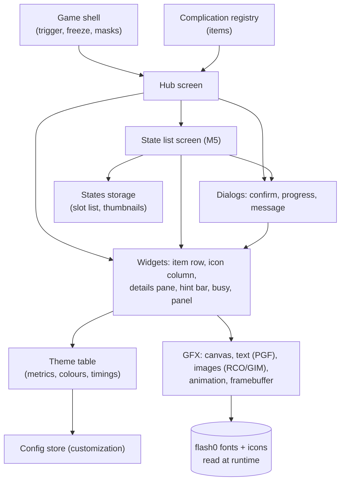
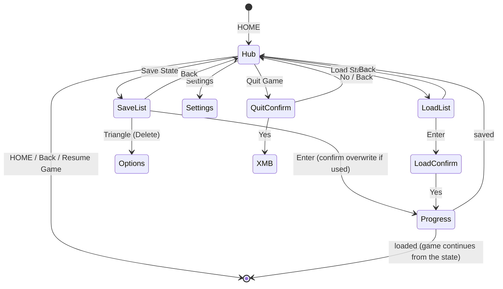

# User interface — specification

| | |
|---|---|
| Area code | `UI` |
| Status | Phase-1 menu **Done** (device-verified 2026-10-16). Hub concept A with the system font (ltn0), fades, eased cursor, Quit Game, message dialogs, native Enter/Back: **implemented 2026-10-16, device test pending**. State list (M5), RCO icons, i18n **Planned** |
| Milestones | M3 phase 1 (done), M4 (native look), M5 (state list) |
| Code | [`ui/hub.c`](../../plugin/src/ui/hub.c), [`ui/views.c`](../../plugin/src/ui/views.c) (portable drawing of every screen), [`ui/dialog.c`](../../plugin/src/ui/dialog.c), [`ui/ui.c`](../../plugin/src/ui/ui.c), [`ui/icons.c`](../../plugin/src/ui/icons.c), [`ui/shapes.c`](../../plugin/src/ui/shapes.c), [`ui/draw.c`](../../plugin/src/ui/draw.c), [`ui/input.c`](../../plugin/src/ui/input.c), [`ui/fb.c`](../../plugin/src/ui/fb.c); host previews [`tests/preview/preview_ui.c`](../../tests/preview/preview_ui.c) |
| Related | [rendering and native assets](rendering.md), [references](references.md), [customization](customization.md), [concepts](../assets/concepts/README.md), [game shell](../subsystems/game-shell.md), [complications](../subsystems/complications.md) |
| Research | [m3-menu-e3](../research/m3-menu-e3.md), [m4-native-look](../research/m4-native-look.md), [m4-native-icons](../research/m4-native-icons.md) |

## A. Overview

### Design philosophy

**The plugin is invisible; the PSP got a new feature.** Every screen is built from the PSP's own
vocabulary — its fonts, icons, colours, layouts, timings, button conventions and wording — read
from the user's PSP at runtime ([ADR-013](../architecture/decisions.md#adr-013--sony-assets-are-read-at-runtime-never-redistributed)). Where the PSP has an equivalent screen (HOME
screen, XMB item list, Saved Data Utility, message dialog), we copy its behaviour and metrics; where
it has none, we compose one from the same parts. Pocketwatch's own identity appears only where the
system would name an application (Settings → About), never as branding over the game.

What "native 1:1" means, measurably (acceptance in §G):

1. Same font files and sizes (ltn0/ltn8 at the XMB's scale), same text colour and shadow.
2. Same geometry within ±2 px of the reference captures for the equivalent screen.
3. Same timings (200 ms fade, 100 ms slide) within one frame.
4. Same button semantics: Enter/Back follow the system setting (○ or ×), HOME toggles, △ opens
   options in lists.
5. Same language as the XMB.

### Current state (VERIFIED, [menu test 2026-10-16](../research/logs/2026-10-16-menu1-castlevania.log))

A NOTE tap shows, over the game's frame dimmed to 96/256, a black band (y 44-227, alpha 150) with
"Pocketwatch" in the 8x8 font at 2x, the tagline, three items (Save state, Load state — greyed
without a state, Resume game) with a white bar on the selected one, a status line ("Saved in 4.2 s")
and the hint "X select O back". X confirms, O/START/NOTE close.

### Target state

HOME opens an XMB-style hub over the frozen, dimmed game; Save/Load open a state list in the style
of the Saved Data Utility; confirmations and errors use the system's message-dialog style; all text
in the system font and language.

## B. Requirements

| ID | Requirement | Priority | Status | Verification |
|---|---|---|---|---|
| `UI-REQ-001` | The hub is drawn over the frozen game's last frame, dimmed; the game's frame itself is never modified. | P0 | Done | device test 2026-10-16 |
| `UI-REQ-002` | Hub items (target): Resume Game, Save State, Load State, Settings, Quit Game, built from the complication registry. | P0 | Implemented (all five, from the complication registry) | device test |
| `UI-REQ-003` | Unavailable items are shown disabled with a reason (e.g. Load State without states); they cannot be confirmed. | P0 | Done (greyed Load) | device test |
| `UI-REQ-004` | Up/Down move the cursor with auto-repeat (400 ms delay, 100 ms interval); Enter confirms, Back goes one level up or closes; HOME closes from any level. | P0 | Partial (repeat, X/O fixed) | host test `keys_edges_and_repeat`, device |
| `UI-REQ-005` | Enter/Back follow the system's button assignment (`sceImposeGetLanguageMode`); the hint bar shows the system's button pictures in the system order. | P0 | Implemented (drawn button symbols until the RCO pictures) | device test with the setting swapped (ARK VSH menu) |
| `UI-REQ-006` | All text uses the system font (ltn0/ltn8; jpn0, kr0 for those languages) at the XMB's sizes, white with the XMB's soft shadow. | P0 | Implemented for Latin (ltn0 at 0.8 and 0.63, two-step shadow) | side-by-side review |
| `UI-REQ-007` | Item icons are the XMB's own (topmenu_icon.rco) where an equivalent exists; otherwise Pocketwatch icons drawn in the same style. | P1 | Planned | review |
| `UI-REQ-008` | Text is in the system language (en, ja, fr, es, de, it, nl, pt, ru, ko at least for item names); missing translations fall back to English. | P1 | Implemented for en, fr, es, de, it, nl, pt, ru (+ uk through `language.txt`), files in `plugin/lang/` (ADR-018); ja/ko/zh fall back to English until their fonts load | `tests/test_i18n.c`, testing guide H9-H11 |
| `UI-REQ-009` | Save State / Load State open a state list in the Saved Data Utility layout: icon column (selected 144x80), details pane (title, date/time, size, detail), banner title, hints; Save offers "New Save State" first. | P1 | Implemented (`ui/slots.c`; host preview `slots-save`) | review vs reference |
| `UI-REQ-010` | Overwrite, load and quit ask for confirmation in the message-dialog style (Yes/No, default No for destructive actions). | P1 | Implemented for overwrite, delete, load and quit | device test |
| `UI-REQ-011` | Long operations show the system's busy indicator and a "Saving..." / "Loading..." message; a refusal or failure shows a message dialog naming the reason in plain words. | P0 | Implemented (drawn busy ring; reasons are generic until the engine reports them) | device test with forced refusals |
| `UI-REQ-012` | A status corner shows the clock and battery like the XMB (optional, setting). | P2 | Implemented (Settings → Clock and Battery) | testing guide ST2 |
| `UI-REQ-013` | The cursor position is remembered while the game runs; the hub reopens on the last item. | P2 | Implemented | device test |
| `UI-REQ-014` | When a native asset cannot be read, the hub still works with fallbacks (built-in 8x8 font, drawn shapes) and logs why. | P0 | Done (8x8 only today) | test with assets missing |
| `UI-REQ-015` | Besides the native look (default), the menu offers the Modern and Minimal styles ([styles](styles.md)), switchable in Settings at once, every screen drawn in each. | P2 | Implemented (host previews) | testing guide ST5 |
| `UI-NFR-001` | First frame ≤ 300 ms after the trigger; redraw only on change; every animation at the display rate (60 Hz) without dropped frames. | P1 | In progress: the owner saw a very low frame rate (2026-10-17); frame cost cut 2-3.5x (tests/bench: the wave's divisions and column-order access, shapes' square roots and divisions per pixel); animations now run by time, not by frame; the hub logs its real fps (testing guide H13) | `make -C tests bench`, log `hub: ... fps` |
| `UI-NFR-002` | Memory: hub buffers and asset caches live in P11 (or P9 when no state is held) and are freed on close; ≤ 2 MB total; nothing large in P1. | P0 | Done for the framebuffer (1.6 MB in P11) | code, `make check` |
| `UI-NFR-003` | Geometry within ±2 px and colours within ±8 per channel of the reference captures for equivalent screens. | P1 | Planned | side-by-side capture comparison |
| `UI-NFR-004` | Legibility: text contrast against the dimmed game ≥ 4.5:1 (dim level and panel alpha chosen for it); no information carried by colour alone. | P1 | Planned | measurement on captures |

## C. Architecture and integration

- **Screens** own navigation state; **widgets** draw from data and the theme; **theme** holds every
  native metric in one table (from [m4-native-look](../research/m4-native-look.md)), so a
  measurement correction is a one-line change.
- **Data in:** items from the [complication registry](../subsystems/complications.md); slots from
  [states storage](../subsystems/states-storage.md); language/button assignment from impose;
  preferences from the [config store](customization.md).
- **Control out:** item actions run in the hub thread with the game frozen; engine work goes through
  the held-freeze API; before a suspend the hub hides its framebuffer and redraws after
  ([ADR-011](../architecture/decisions.md#adr-011--own-overlay-framebuffer-never-the-games)).
- **Lifecycle:** open → load assets (before the freeze, cached for the boot when memory allows) →
  first frame → event loop at vblank → close → free buffers.
- **Failure:** missing asset → fallback; allocation failure → close and thaw with a log line;
  engine failure → message dialog, hub stays open.

## D. User experience and visual design

### Screens and navigation

1. **Hub** (PROPOSED, two layouts to choose from — see [concepts](../assets/concepts/README.md)):
   - *Concept A, item column (recommended for v0.1):* the XMB's vertical item list alone: a small
     category icon at the XMB's open-category position, items with 64x64-class icons, the selected
     row at y ≈ 135, title ≈ 14 px, a one-line description under the selected item ≈ 11 px.
   - *Concept B, full cross:* complications as categories on a horizontal bar (80 px pitch), items
     below; worth it once there are several complications.
2. **State list** (M5): Saved Data Utility layout ([m4-native-look §3c](../research/m4-native-look.md#3-system-ui-metrics)) with the
   state's screenshot as the background picture (PIC1 behaviour), slot icon (ICON0) column,
   details pane; "New Save State" first in Save mode.
3. **Dialogs:** message dialog layout (white rules x 60-420 around centred text, Yes/No), progress
   (busy icon + "Saving..."), refusal messages ("This state was saved with a different setup and
   cannot be loaded.").
4. **Settings** (later): XMB-style option list (see [customization](customization.md)).

### States of every screen

| State | Behaviour |
|---|---|
| Loading | assets read before the freeze; if it takes > 100 ms, the busy indicator over the dimmed frame |
| Empty | Load State disabled with "No saved states"; list shows "No saved states" centred |
| Disabled | greyed text (50 % alpha), Enter does nothing, the reason in the description line |
| In progress | busy indicator, input ignored except nothing; the screen is hidden during the suspend (black) |
| Error | message dialog with the reason and one action (OK); the game is untouched |
| Recovery | after a failed load: hub stays open on Load State, message explains; after a refused save: same |

### Motion, sound, input

- Open: dim + panel fade-in 200 ms; close: fade-out 200 ms (after the release wait). Cursor moves
  without animation in v0.1 (the XMB eases rows; later).
- Sound: the XMB's cursor/confirm/back sounds — **RESEARCH REQUIRED** (where they live, how to play
  them from kernel mode while the game is frozen); silent in v0.1.
- Input: D-pad, Enter/Back per system, △ options, HOME close. Analog stick: ignored.

### Accessibility and usability

Text from the system's fonts at the XMB's sizes (no smaller than ≈ 11 px), white on a dimmed
background with the XMB's shadow; disabled state shown by both alpha and a text reason; no timed
interactions; every destructive action confirmed with No as the default.

## E. Reference material

See [references.md](references.md) for the curated library (sources, what to learn, what to avoid,
licenses) and [concepts](../assets/concepts/README.md) for Pocketwatch's own proposals.

## F. Implementation plan

1. **Native-asset groundwork (GFX):** PGF decoder (rev 2, overlays) + glyph cache; RLZ decoder +
   RCO reader + GIM decoder; month colour BMP; fallbacks. Host tests with synthetic files generated
   by our own encoders (no Sony files in the repository). → [rendering](rendering.md)
2. **Theme table** with the metrics above; **widgets** (item row, hint bar, panel, busy, message
   dialog).
3. **Hub rewrite** on the complication registry (Concept A unless the owner picks B), HOME trigger
   from the [game shell](../subsystems/game-shell.md), Quit Game.
4. **Language + button assignment** from impose; string tables.
5. **Device comparison:** a debug capture of the real HOME screen / XMB / Saved Data Utility
   (kept off the repository) and of ours, compared side by side; tune the theme.
6. **State list** with M5.

Migration: the phase-1 menu is replaced; `ui/draw.c` and `ui/input.c` stay (canvas primitives,
input logic); `font8x8` stays as the fallback.

## G. Testing and acceptance

| Requirement | Test | Acceptance criterion | Needs |
|---|---|---|---|
| UI-REQ-004/005 | Host tests for navigation state machines; device test with the button setting swapped | Enter/Back follow the setting; hints match | ARK VSH menu swap |
| UI-REQ-006/007, UI-NFR-003 | Capture ours and the system's equivalent screen; overlay them on the PC | ±2 px geometry, ±8 colour; owner accepts | debug capture combo |
| UI-REQ-008 | Switch the system language to French and Japanese | item names translated, fonts correct | PSP |
| UI-REQ-011 | Force refusals (highmem game, damaged state) | message dialog with the reason; game unaffected | debug hooks |
| UI-REQ-014 | Rename the asset path in a debug build | hub works with fallbacks | debug build |
| UI-NFR-001 | Timestamps from trigger to first `pw_fb_present` | ≤ 300 ms | log |
| Golden images | Host renders of each screen with synthetic fonts/icons compared to stored PNGs | identical | host tests |

## H. Risks and decisions

- Risks: [RISK-010](../risk-register.md#risk-010--parsing-sony-assets-on-the-device) (asset parsing), [RISK-005](../risk-register.md#risk-005--kernel-ram-and-prx-size-growth) (size), [RISK-009](../risk-register.md#risk-009--home-takeover-side-effects) (HOME).
- Decisions: [ADR-011](../architecture/decisions.md#adr-011--own-overlay-framebuffer-never-the-games), [ADR-012](../architecture/decisions.md#adr-012--home-opens-the-hub-and-replaces-the-system-home-screen), [ADR-013](../architecture/decisions.md#adr-013--sony-assets-are-read-at-runtime-never-redistributed), [ADR-009](../architecture/decisions.md#adr-009--complication-framework-and-ui-layering).
- **OPEN QUESTION (owner):** hub Concept A (item column) or B (full cross) for v0.1.
- **OPEN QUESTION (owner):** show "Pocketwatch" anywhere in the hub, or only in Settings → About.
- **RESEARCH REQUIRED:** the real in-game HOME screen's exact look on 6.61 (device capture); XMB
  sounds; which `topmenu_icon.rco` labels map to the icons we need.
